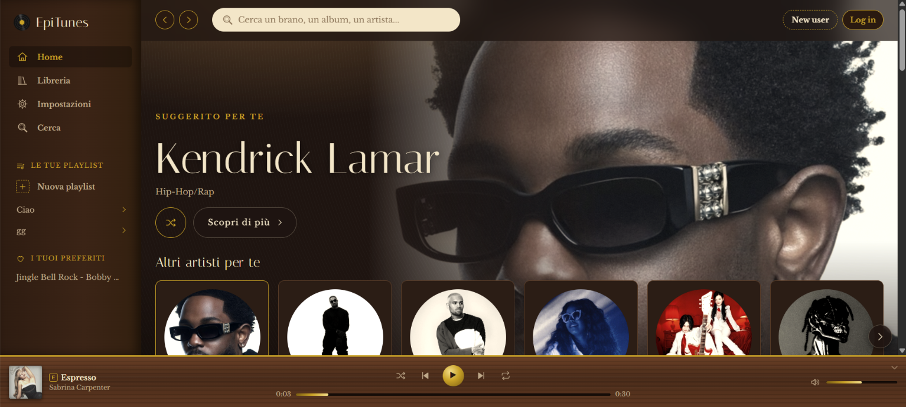
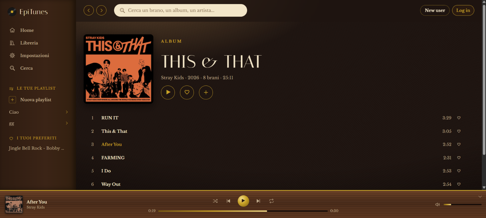
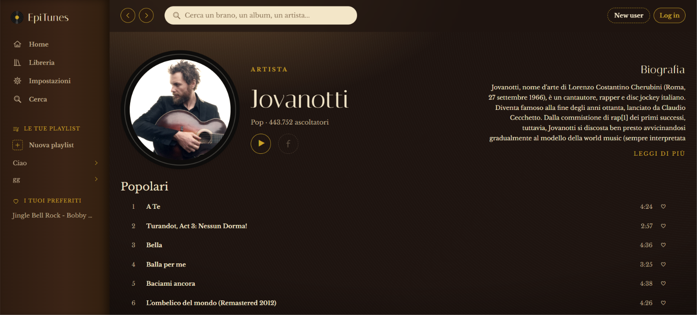
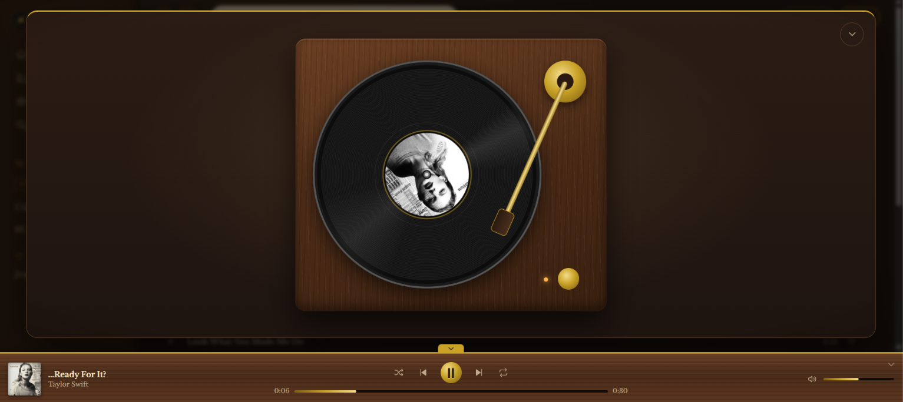
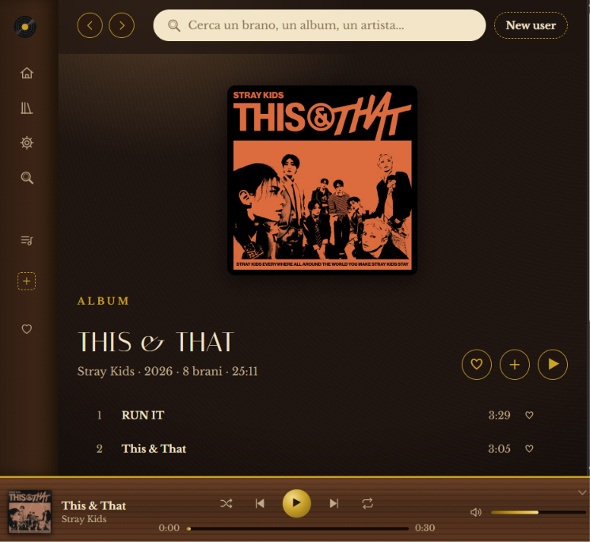
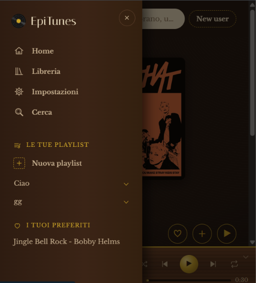
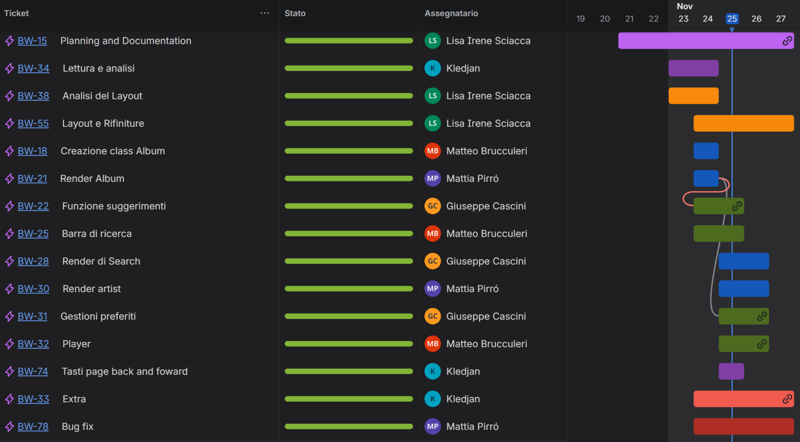

#  EPITUNES - Web app musicale

---

        

Questa repository contiene il codice sorgente di **EpiTunes**, una web app musicale ispirata a Spotify e realizzata come progetto di gruppo (Build Week 2) per il corso di sviluppo web front-end di Epicode. L'applicazione permette di esplorare brani, album e artisti tramite l'API di iTunes, ascoltare le anteprime dei brani, salvare i preferiti, creare playlist, registrarsi e accedere con un account, e personalizzare l'esperienza con temi e opzioni di accessibilità.

---

> 🟡 **Stato del progetto:** funzionalità principali completate e funzionanti, in fase di rifinitura. Questo file viene aggiornato a mano a mano che il progetto viene realizzato.

## 📑 Indice

- [Anteprime](#-anteprime)
- [Funzionalità](#-funzionalità)
- [Tecnologie Utilizzate](#-tecnologie-utilizzate)
- [Come Eseguire il Progetto Locale](#-come-eseguire-il-progetto-locale)
- [Struttura del progetto](#-struttura-del-progetto)
- [Architettura, Responsive Design e Media Query](#-architettura-responsive-design-e-media-query)
- [Albero del dom](#-albero-del-dom)
- [Validazione dei Campi del Form](#-validazione-dei-campi-del-form)
- [Come funziona](#-come-funziona)
- [Aspetto grafico](#-aspetto-grafico)
- [Extra e dettagli](#-extra-e-dettagli)
- [Convenzioni di codice](#-convenzioni-di-codice)
- [Aggiornamenti](#-aggiornamenti)
- [Organizzazione del lavoro](#-organizzazione-del-lavoro)
- [Realizzato da](#-realizzato-da)

## 🖼️ Anteprime

| Home | Album |
| :---: | :---: |
|  |  |
| **Artista** | **Giradischi** |
|  |  |
| **Tablet** | **Mobile** |
|  |  |

### ✨ Funzionalità

L'applicazione offre un'interfaccia in stile Spotify, strutturata con Bootstrap 5 e CSS moderno e resa dinamica con JavaScript nativo:

- **Layout a 3 zone**: Sidebar, main e player condivisi dalle sei pagine (`index.html`, `library.html`, `search.html`, `album.html`, `artist.html`, `playlist.html`), costruiti con CSS Grid e `grid-template-areas`.
- **Sidebar con playlist e preferiti**: Navigazione (Home, Libreria, Impostazioni, Cerca) con il link della pagina corrente evidenziato, pulsante "Nuova playlist", le ultime 5 playlist (con i brani in un menu a tendina) e gli ultimi 5 preferiti. I titoli "Le tue playlist" e "I tuoi preferiti" portano alla relativa sezione della Libreria.
- **Home personalizzata**: Hero con un artista suggerito e il carosello "Altri artisti per te", righe "Riprodotti di recente", "Preferiti" e suggerimenti di brani e album per genere. I generi si ricavano dagli ascolti dell'utente o, se non ce ne sono, dai gusti scelti alla registrazione.
- **Ricerca**: Campo di ricerca con debounce di 400ms che interroga l'API di iTunes e mostra i risultati divisi in tre sezioni (brani, album, artisti) tramite `Promise.all`. Anche le card degli album hanno il cuore (tutto l'album nei preferiti) e il + (tutto l'album in una playlist). Le sezioni senza risultati restano nascoste e l'ultima ricerca viene salvata in `localStorage`.
- **Pagina Album**: Lettura dell'id dalla query string con `URLSearchParams`, hero con copertina, titolo, artista, anno, numero di brani e durata totale, pulsanti per riprodurre l'album, aggiungerlo ai preferiti o a una playlist, e tracklist numerata.
- **Pagina Artista**: Hero con foto, nome, genere e ascoltatori (numero simulato, perché le API non lo forniscono), pulsante Facebook e anteprima della biografia (foto, biografia e Facebook da TheAudioDB), brani popolari e carosello degli album consigliati. "Leggi di più" compare solo quando la biografia supera i 300 caratteri.
- **Libreria**: Le playlist dell'utente (con la × sulla card per eliminarle), la lista a tendina dei brani preferiti e gli ascoltati di recente, con il conteggio dei brani salvati.
- **Playlist**: Creazione dalla sidebar o dalla modale "Aggiungi a playlist", aggiunta di singoli brani o di interi album, pagina dedicata con riproduzione, rinomina, eliminazione della playlist e rimozione dei brani.
- **Riproduzione**: Anteprime audio con play/pausa, brano precedente e successivo, casuale e ripeti, barre di avanzamento e volume cliccabili e trascinabili. Il brano in ascolto viene evidenziato nella tracklist e il player riprende da dove era rimasto cambiando pagina.
- **Giradischi**: La linguetta sopra il player apre un giradischi a tutto schermo: il vinile gira con la copertina del brano al centro e il braccio si appoggia sul disco mentre la musica suona.
- **Preferiti**: Cuore su card, righe e hero per aggiungere o togliere un brano (o un intero album) dai preferiti, con la sidebar aggiornata subito.
- **Registrazione e login**: Il pulsante "New user" apre il form di registrazione; dopo la registrazione una seconda modale chiede generi e artisti preferiti. "Log in" apre la modale di accesso (dalle altre pagine porta alla home e la apre subito); una volta collegati il pulsante diventa "Esci".
- **Impostazioni**: Modale con la scelta del tema (Vintage o Stagionale), le opzioni di accessibilità (alto contrasto, testo più grande, riduci animazioni) e l'interruttore dei contenuti espliciti. Le scelte restano salvate in `localStorage`.
- **Condividi EpiTunes**: Cliccando il logo si apre una modale che invita a condividere l'app con gli amici; "Invita i tuoi amici" apre la condivisione del telefono o del browser e, se non è disponibile, copia il link negli appunti.
- **Responsive Design**: Sidebar a pannello su mobile e a sole icone su tablet, player su due colonne su schermi piccoli, hero e card che si adattano alla larghezza del main.

## 🛠️ Tecnologie Utilizzate

- **HTML5**: Strutturazione semantica delle pagine, Popover API (`popover`, `popovertarget`) per il menu a pannello su mobile e per le modali Condividi e Biografia.
- **CSS3 moderno**: Custom properties, nesting nativo, `grid-template-areas`, container queries, `:has()`, `color-mix()`, `@starting-style` e transizioni con `allow-discrete`, animazioni con `@keyframes` e media query con range syntax.
- **Bootstrap 5.3.8**: Tema scuro (`data-bs-theme="dark"`), reboot, utility di layout e, con il bundle JavaScript, i menu a tendina (dropdown) e la lista a tendina dei preferiti (collapse).
- **Google Fonts**: Italiana per logo e titoli, Libre Baskerville per il testo.
- **Icone SVG**: Set di icone personalizzate raccolte in uno sprite all'inizio di ogni pagina.
- **JavaScript (ES6+)**: Moduli ES (`import`/`export`), chiamate `fetch` asincrone, classi OOP, manipolazione del DOM con `createElement`, gestione del player, del `localStorage` e degli eventi personalizzati.
- **iTunes Search API**: Fonte dei dati di brani, album, artisti, copertine e anteprime audio.
- **TheAudioDB API**: Foto, biografia e pagina Facebook degli artisti.
- **json-server 0.17.4 + json-server-auth 2.1 (cartella `server/`)**: Server locale che gestisce registrazione e login, salvando gli utenti in `db.json`.
- **Web Share API**: Condivisione dell'app dal pulsante "Invita i tuoi amici", con la copia del link negli appunti (Clipboard API) quando il browser non la supporta.

## 🚀 Come Eseguire il Progetto Locale

1. **Clona il repository**:
   ```bash
   git clone https://github.com/Kledjan00/Build-Week-2
   ```

2. **Apri l'applicazione**:
   Apri il progetto con un'estensione come **Live Server** su VS Code e avvia `index.html`. Il JavaScript è organizzato in moduli ES, che il browser blocca se la pagina viene aperta direttamente dal file (indirizzo `file://`).

3. **Avvia il server per registrazione e login** (facoltativo):
   Nella cartella `server/` installa le dipendenze e avvia il server:
   ```bash
   npm install
   npm run server
   ```
   Lo script lancia `json-server-auth db.json --port 3001`: il sito cerca il server all'indirizzo `http://localhost:3001`. Senza il server tutto il resto dell'app funziona, ma registrazione e login danno errore. Il file `.vscode/settings.json` dice a Live Server di ignorare `db.json`, così la pagina non si ricarica a ogni nuova registrazione.

---

## 📁 Struttura del progetto

```text
.
├── .vscode/
│   └── settings.json      impostazioni dell'editor
├── assets/
│   ├── css/
│   │   └── app.css        stile personalizzato, tema vintage, temi, accessibilità e layout a 3 zone
│   ├── img/
│   │   ├── *-desktop.png, album-tablet.png, menu-mobile.png   anteprime del sito per il README
│   │   ├── epicode-logo.png      logo Epicode
│   │   ├── Gant.png              diagramma di Gantt dell'organizzazione del lavoro
│   │   ├── logo-epitunes.svg     logo EpiTunes (il disco in vinile) usato nel titolo del README
│   │   └── placeholderArtist.png disco in vinile usato quando manca la foto dell'artista
│   └── js/
│       ├── helper.js      funzioni di utilità: el, $, debounce, fetch, cronologia, preferiti, playlist e modale "Aggiungi a playlist"
│       ├── common.js      impostazioni, classi modello, classe Player, sidebar e initPage
│       ├── auth.js        registrazione e login tramite il server locale
│       ├── new-user.js    modale di registrazione e modale "Cosa ascolti di solito"
│       ├── home.js        hero degli artisti suggeriti e righe della home
│       ├── library.js     pagina Libreria
│       ├── search.js      ricerca e rendering dei risultati
│       ├── album.js       dettaglio album e tracklist
│       ├── artist.js      dettaglio artista, biografia, brani popolari e album consigliati
│       └── playlist.js    dettaglio playlist, rinomina ed eliminazione
├── server/
│   ├── db.json            utenti registrati
│   ├── package.json       dipendenze e script del server
│   ├── package-lock.json  versioni esatte delle dipendenze
│   └── ...                settings.json, .gitignore
├── index.html             home
├── library.html           libreria
├── search.html            pagina di ricerca
├── album.html             pagina di dettaglio album
├── artist.html            pagina di dettaglio artista
├── playlist.html          pagina di dettaglio playlist
└── readme.md              documentazione del progetto
```

---

## 📱 Architettura, Responsive Design e Media Query

L'architettura del progetto è **multi-pagina**: ogni pagina condivide la stessa struttura a 3 zone, gestita in `app.css` con CSS Grid e `grid-template-areas`:

- **Sidebar** a sinistra con la navigazione, le playlist e i preferiti.
- **Main** al centro con la topbar sticky e il contenuto della pagina.
- **Player** in basso su tutta la larghezza: compare solo dopo che è stato scelto un brano.

La sidebar è scritta nell'HTML e il JavaScript riempie solo le liste di playlist e preferiti. Il player è **dinamico**: `initPage()` in `common.js` lo costruisce con `Player.mount()` dentro il `<footer class="player">`.

Il layout si adatta allo schermo con media query sui breakpoint di Bootstrap:

- **Mobile (<576px)**: La sidebar diventa un pannello che si apre dal pulsante ☰ della topbar (Popover API, senza JavaScript), layout a una colonna, player su 2 colonne senza il controllo del volume, campi delle modali uno sotto l'altro.
- **Tablet (576px - 767px)**: Sidebar ridotta a 80px con le sole icone, comprese quelle di "Le tue playlist" e "I tuoi preferiti" che portano alla Libreria; il pulsante "Log in" è nascosto per lasciare spazio alla ricerca.
- **Desktop (≥768px)**: Sidebar completa da 240px con titoli, playlist e preferiti.
- **Fino a 956px**: Nell'hero di album, artista e playlist la copertina va al centro, con sotto i testi a sinistra e i pulsanti a destra.

Oltre alle media query, il main è un **container** (`container: main / inline-size`): hero, card e caroselli si adattano alla larghezza del main e non a quella della finestra.

- **Main < 1000px**: Nella pagina artista la biografia va sotto l'hero.
- **Main < 720px**: Hero in colonna, copertina ridotta e caroselli con 3 card alla volta invece di 6.
- **Main < 540px**: Card della griglia con larghezza minima di 140px invece di 180px.

---

## 🌳 Albero del dom

Struttura comune a tutte le pagine:

* **Link "Vai al contenuto" (`<a class="skip-link">`)**: Si vede solo con il tasto Tab e porta direttamente al contenuto.
* **Sprite delle icone (`<svg style="display: none">`)**: Raccolta di `<symbol>` (`#ico-home`, `#ico-search`, `#ico-library`, `#ico-settings`, `#ico-playlist`, `#ico-heart`, `#ico-plus`, `#ico-menu`, le frecce e i comandi del player) richiamati con `<use href="#ico-...">`.
* **Contenitore (`<div class="app">`)**: Griglia a 3 zone che contiene tutta l'interfaccia.
  * **Sidebar (`<aside class="sidebar" id="sidebar-drawer" popover>`)**:
    * `.drawer-close`: × per chiudere il pannello (solo su mobile).
    * `.brand`: Pulsante con il logo a disco (`.brand-mark`) e il nome `EpiTunes`, apre la modale Condividi.
    * `.sidebar-nav`: Link Home, Libreria e Cerca e pulsante `#btn-settings`.
    * `.sidebar-section-title` "Le tue playlist", pulsante `#btn-new-playlist` e lista `#sidebar-playlists`.
    * `.sidebar-section-title` "I tuoi preferiti" e lista `#sidebar-favourites`.
  * **Contenuto (`<main class="main" id="contenuto">`)**:
    * **Topbar (`<header class="topbar">`)**: Pulsante `.menu-btn` (☰, solo su mobile), bottoni `.nav-btn` Indietro/Avanti, barra di ricerca (link a `search.html`, oppure il campo `#search-input` nella pagina di ricerca), pulsanti `#btn-new-user` e `#btn-user`.
    * **Sezione della pagina**: Cambia in base alla pagina (vedi sotto).
  * **Player (`<footer class="player">`)**, generato da `Player.mount()`:
    * `.player-track`: Copertina `#player-cover-img`, titolo `#player-title` e artista `#player-artist-link`.
    * `.player-center`: Comandi `#btn-shuffle`, `#btn-prev`, `#btn-play`, `#btn-next`, `#btn-repeat` e barra di avanzamento (`#time-current`, `#progress-bar`, `#progress-fill`, `#time-total`).
    * `.player-right`: Icona del volume e barra `#volume-bar` / `#volume-fill`.
    * `#btn-close-player` (nasconde il player) e `#btn-expand-player` (linguetta che apre il giradischi).
  * **Audio (`<audio id="audio-element">`)**: Elemento che riproduce le anteprime dei brani.
* **Finestre modali**:
  * `#expandPlayer`: Giradischi, con la copertina del brano `#expand-cover` e il pulsante di chiusura `#expand-close`.
  * `#register-modal`: Form di registrazione `#register-form`.
  * `#welcome-modal`: "Cosa ascolti di solito?", con le liste `#genre-list` e `#artist-list`.
  * `#share-modal`: "Condividi EpiTunes" (popover).
  * `#settings-modal`: Impostazioni, con la tendina del tema `#theme-toggle` e gli interruttori `#setting-contrast`, `#setting-large-text`, `#setting-reduce-motion`, `#setting-explicit`.
  * `.playlist-modal-overlay`: "Aggiungi a playlist", creata dal JavaScript quando si clicca un +.

Sezioni delle singole pagine:

* **Home (`index.html`)**:
  * `#home-hero`: Artista suggerito con foto di sfondo `#home-hero-bg`, nome `#hero-artist-name`, pulsanti `#hero-shuffle` e `#hero-more` e carosello `#hero-artists`.
  * `<section class="home">`: Righe `<article class="row">` generate dal JavaScript, ognuna con il titolo e un carosello di card.
  * `#login-modal`: Modale di accesso con il form `#login-form`.
  * `.xmas-snow`: Fiocchi di neve del tema stagionale.
* **Libreria (`library.html`)**: Intestazione con il conteggio `#library-count` e le sezioni `#row-library-playlist`, `#row-library-favourites` e `#row-library-history`.
* **Ricerca (`search.html`)**: Tre sezioni nascoste di default (`#row-tracks`, `#row-albums`, `#row-artists`) con le griglie `#grid-tracks`, `#grid-albums`, `#grid-artists`.
* **Album (`album.html`)**: `#album-hero` (copertina, testi e pulsanti `.btn-play-big`, `.btn-fav-big`, `.btn-plus-big`) e `#tracklist` con le righe `.track-row`.
* **Artista (`artist.html`)**: `#artist-hero` (foto, testi, play, pulsante Facebook e biografia `.bio-aside`), `#top-tracks` con i brani popolari, carosello degli album consigliati e modale `#bio-modal` con la biografia completa.
* **Playlist (`playlist.html`)**: `#playlist-hero` (copertina, testi, play, rinomina `#rename-btn` ed elimina) e `#tracklist`.

---

## ✅ Validazione dei Campi del Form

### 1. Regole di Validazione HTML5

| Campo | Regola | Cosa controlla il browser |
| ----- | ----- | ----- |
| **Nome utente** | `required` + `minlength="3"` | Che non sia vuoto e abbia almeno 3 caratteri |
| **E-mail** | `type="email"` + `required` | Che non sia vuota e abbia un formato valido tipo `nome@dominio.it` |
| **Password** | `type="password"` + `required` + `minlength="8"` | Che non sia vuota e abbia almeno 8 caratteri |
| **Ripeti password** | `required` | Che non sia vuota |
| **Data di nascita** | `type="date"` + `required` | Che sia una data |
| **Consenso** | `type="checkbox"` + `required` | Che sia spuntato |

### 2. Controllo tramite JavaScript (`new-user.js`)

I controlli che l'HTML non può fare li esegue lo script all'invio del form:

```javascript
if (repeatInput.value !== passwordInput.value) {
    showError(repeatError, "Le password non coincidono", repeatInput);
    isValid = false;
}
if (new Date(birthInput.value) > new Date()) {
    showError(birthError, "la data non può essere nel futuro", birthInput);
    isValid = false;
}
```

`showError()` scrive il messaggio nel `<p class="register-error">` sotto il campo e imposta `aria-invalid="true"` sull'input; `clearErrors()` toglie tutti gli errori prima di ogni nuovo invio.

### 3. Visualizzazione degli Errori (CSS + HTML)

- Ogni campo ha sotto un `<p class="register-error" aria-live="polite">`, alto anche da vuoto, così quando compare un errore il form non si sposta. `aria-live` fa leggere l'errore ai lettori di schermo.
- I campi con `aria-invalid="true"` hanno il bordo rosso mattone.

**Sequenza di invio:**
> Clic su Registrati → il browser controlla le regole HTML5 → `preventDefault()` blocca l'invio nativo → `clearErrors()` toglie gli errori precedenti → controllo delle password e della data → se c'è un errore compare sotto il campo e lo script si interrompe → se è tutto valido, `signUp()` invia i dati al server → se la registrazione riesce si chiude la modale e si apre "Cosa ascolti di solito?", altrimenti l'errore compare sotto l'e-mail.

---

## ⚙️ Come funziona

Il codice JavaScript è organizzato in **moduli ES**: ogni pagina carica `new-user.js`, `common.js` e il proprio file, che importa quello che gli serve.

1. **Funzioni di utilità (`helper.js`)**:
   - `el()` crea un elemento con `createElement`, assegnandogli classi, id, testo, attributi, stile e figli; `$()` è una scorciatoia di `querySelector`.
   - `debounce()` ritarda l'esecuzione di una funzione finché l'utente non smette di scrivere.
   - `fetchModular()` interroga l'API di iTunes con i parametri scelti (`media`, `entity`, `attribute`, `limit`); `getArtistPicture()` cerca la foto dell'artista su TheAudioDB.
   - `historyLog()` e `historyDump()` gestiscono la cronologia (massimo 12 brani, senza duplicati); `getFavourites()`, `isFavourite()` e `toggleFavourite()` gestiscono i preferiti.
   - `getPlaylist()`, `setPlaylist()`, `addTrackToPlaylist()`, `removeTrackFromPlaylist()`, `renamePlaylist()` e `killPLaylist()` gestiscono le playlist in `localStorage`.
   - `setCurrentTrackList()` e `getCurrentTrackList()` salvano la lista in riproduzione, così avanti e indietro funzionano anche cambiando pagina.
   - `showPlaylistModal()` costruisce la modale "Aggiungi a playlist": mostra le playlist che non contengono già il brano (o l'album), permette di crearne una nuova e si chiude con la X, con Esc o cliccando fuori.
2. **Funzioni comuni (`common.js`)**:
   - `bigArt()` trasforma la copertina 100x100 dell'API in una 600x600; `formatTime()` converte i millisecondi in `m:ss`.
   - **Impostazioni**: `getSettings()` legge le scelte salvate, `applySettings()` le traduce in classi (`a11y-contrast`, `a11y-large-text`, `a11y-reduce-motion`, `hide-explicit`) e nell'attributo `data-theme` su `<html>`, e `initSettings()` collega interruttori e tendina del tema. Tutto il resto lo fa il CSS.
   - La classe `Player` gestisce l'elemento `<audio>`. `mount()` costruisce il player; `play(track, trackList)` avvia un brano e imposta la lista per avanti e indietro; `next()`, `prev()`, `shuffle()` e il pulsante Ripeti gestiscono la coda (Casuale mescola la lista con l'algoritmo Fisher-Yates tenendo in testa il brano in ascolto e resta acceso per tutta la sessione grazie a `sessionStorage`); `makeDraggable()` rende trascinabili le barre con gli eventi pointer; `saveState()` e `restoreState()` salvano e ripristinano il brano, il punto di ascolto e la ripetizione; `expand()` apre il giradischi e `close()` nasconde il player con un'animazione.
   - `renderSidebarFavs()` e `renderSidebarPlaylists()` riempiono la sidebar; l'evento personalizzato `playlists:changed` la aggiorna quando cambia una playlist.
   - `initPage()` monta il player, la sidebar e le impostazioni in ogni pagina e restituisce il player.
3. **Registrazione e login (`auth.js` e `new-user.js`)**:
   - `signUp()` invia i dati al server con `fetch` (metodo POST) e fa subito l'accesso; `logIn()` salva il token e l'utente in `localStorage`, così l'accesso resta anche ricaricando.
   - `showUser()` mostra "Log in" oppure "Esci (nome utente)"; cliccando "Esci" l'utente si scollega.
   - Dopo la registrazione, la modale "Cosa ascolti di solito?" salva i generi e gli artisti scelti (almeno tre) e lancia l'evento `tastes:changed`, che aggiorna i suggerimenti della home.
4. **Home (`home.js`)**:
   - `loadHome()` ricava i generi più ascoltati (o quelli scelti alla registrazione) e cerca in parallelo con `Promise.all` brani e album di quei generi, escludendo quelli già ascoltati.
   - `renderRow()` crea una riga con il titolo e un carosello di card; `buildCarousel()` aggiunge le frecce, che scorrono 6 card alla volta e spariscono a inizio e fine fila.
   - `renderCard()` crea una card per brano (clic per riprodurre, cuore e +); `renderAlbumCard()` una card per album, che apre `album.html?id=...`.
   - `renderHero()` mostra un artista suggerito con la foto di sfondo; cliccando un artista del carosello diventa lui l'artista dell'hero, "Casuale" fa partire un suo brano a caso e "Scopri di più" porta alla sua pagina. Ogni nuova chiamata di `renderHero()` annulla la precedente con un `AbortController`, così dopo il cambio dei gusti listener e richieste non si sommano.
   - Arrivando con il link `index.html#login` si apre subito la modale di login.
5. **Libreria (`library.js`)**: Costruisce i caroselli delle playlist e degli ascoltati di recente e la lista a tendina dei preferiti (componente collapse di Bootstrap), e aggiorna il conteggio dei brani salvati.
6. **Ricerca (`search.js`)**:
   - L'evento `input` su `#search-input` lancia la ricerca con un debounce di 400ms.
   - Le tre chiamate (brani, album, artisti) partono in parallelo con `Promise.all`; i risultati arrivati quando l'utente ha già scritto altro vengono ignorati.
   - Le foto degli artisti arrivano da TheAudioDB e gli artisti doppi vengono scartati; ogni sezione viene mostrata solo se ha risultati.
7. **Album (`album.js`)**:
   - `loadAlbum()` legge l'id con `URLSearchParams` e chiama `lookup?id=...&entity=song`: il primo risultato è l'album, gli altri sono i brani.
   - Calcola l'anno dalla data di uscita e la durata totale sommando le durate dei brani con `reduce()`.
   - Il cuore dell'hero aggiunge o toglie tutti i brani dai preferiti, il + li aggiunge tutti a una playlist; il clic su una riga avvia il brano, che viene evidenziato con la classe `is-playing`.
8. **Artista (`artist.js`)**: Legge l'id con `URLSearchParams`, chiama `lookup?id=...&entity=song` e costruisce l'hero e i 10 brani popolari. In parallelo chiede a TheAudioDB foto, pagina Facebook e biografia: il pulsante Facebook apre la pagina oppure resta spento con la nuvoletta "Pagina Facebook non disponibile", e "Leggi di più" apre la biografia completa nella modale. Sotto carica gli album dell'artista in un carosello.
9. **Playlist (`playlist.js`)**: Legge la playlist da `localStorage` con l'id della query string e costruisce hero e tracklist; permette di rinominarla (il titolo diventa un campo, Invio conferma ed Esc annulla), di eliminarla e di togliere i singoli brani.

---

## 🎨 Aspetto grafico

L'applicazione ha un tema **vintage ispirato ai giradischi di vecchio stampo**, con un layout a 3 zone che resta uguale in tutte le pagine. La palette si basa sui toni del legno: marrone quasi nero per lo sfondo (`#1e1410`), marrone scuro per card e tracklist (`#2b1d15`), sidebar in noce scuro liscio e player in legno di noce con le venature orizzontali, separato dal resto da un profilo in ottone. L'ottone (`#c9a227`) è il colore d'accento di link attivi, bordi, pulsanti e brano in riproduzione; l'avorio (`#f3e6c8`) è usato per il testo principale e il beige (`#bfa98a`) per le informazioni secondarie, mentre il rosso mattone (`#b5432f`) è riservato ai preferiti e agli errori. Il logo e i titoli usano il font art déco **Italiana**, il testo il serif **Libre Baskerville**. Le icone sono disegnate a linea sottile con estremità arrotondate e le copertine hanno una leggera tinta seppia; la copertina del player sembra la busta consumata di un vinile e la foto dell'hero della home ha la grana di una pellicola. Al passaggio del mouse le card si sollevano, la copertina si scurisce e compare al centro un pulsante play trasparente. Nelle pagine di album, artista e playlist i pulsanti dell'hero sono cerchi uguali in ottone e nella pagina artista la foto prende la forma di un vinile. Le modali riprendono lo stesso stile, con il riquadro in legno scuro, il profilo in ottone, il titolo in Italiana e, in alcune, una foto d'epoca che sfuma nel legno. Dalle Impostazioni si può scegliere il tema **Stagionale**. Per adesso è disponibile solo in versione natalizia, che aggiunge neve sopra il player, una pallina di Natale al posto del logo, agrifoglio e lucine sul giradischi e una breve nevicata sulla home, e l'**alto contrasto**, che porta tutto su nero, bianco e giallo. In futuro contiamo di implementare una versione che cambia in base alla festività o la stagione in corso.

---

## 💿 Extra e dettagli

- **Bootstrap 5.3.8 e CSS moderno** Il layout è stato rifatto con Bootstrap e CSS moderno (nesting nativo, container queries, `:has()`, `color-mix()`), mantenendo gli stessi nomi di classe usati dal JavaScript. Gestito da css.
- **Tema vintage giradischi** Palette legno, ottone e avorio, venature del legno nel player, copertine con tinta seppia, copertina del player come una busta consumata e foto dell'artista a forma di vinile. Gestito da css.
- **Font art déco** Italiana per logo e titoli, Libre Baskerville per il testo. Gestito da css.
- **Icone SVG personalizzate** Icone a linea sottile in uno sprite SVG, colorate con il colore del testo. Gestite da html, css e js.
- **Logo a disco animato** Il logo è un piccolo vinile con l'etichetta in ottone: con il passaggio del mouse gira a circa 33 giri e si solleva, quando il mouse esce rallenta per inerzia fino a fermarsi. Gestito da css.
- **Card in stile Spotify** Con il passaggio del mouse la card si solleva, la copertina si scurisce e compaiono il play al centro, il cuore e il +; il cuore resta rosso quando il brano è tra i preferiti. Gestito da css e js.
- **Hero della home e caroselli** Artista suggerito con foto di sfondo e carosello di altri artisti; tutte le righe sono caroselli con le frecce ai lati. Gestito da html, css e js.
- **Libreria** Pagina con playlist, preferiti a tendina e ascoltati di recente, raggiungibile anche dai titoli della sidebar. Gestito da html, css e js.
- **Playlist** Creazione, rinomina (con l'icona della penna d'oca) ed eliminazione delle playlist, aggiunta di brani o di interi album dalla modale "Aggiungi a playlist". Gestito da js e css.
- **Player completo** Avanti, indietro, casuale e ripeti, barre trascinabili con un'area cliccabile più alta di quella visibile, player che compare al primo brano, si nasconde con la freccia in alto a destra e riprende cambiando pagina. Gestito da js e css.
- **Giradischi** Player espanso con vinile che gira, copertina al centro, braccio che si appoggia sul disco e spia accesa mentre la musica suona. Gestito da html, css e js.
- **Registrazione, gusti musicali e login** Form di registrazione con controlli e messaggi di errore, modale per scegliere generi e artisti che personalizzano la home, accesso con un server locale. Gestito da html, css e js.
- **Impostazioni e temi** Modale con il tema Vintage (predefinito) e il tema Stagionale natalizio; Disco è segnato "Coming soon". Gestito da html, css e js.
- **Accessibilità** Alto contrasto, testo più grande e riduci animazioni dalle Impostazioni; il sito rispetta anche il "riduci movimento" del sistema. Link "Vai al contenuto", contorno di focus visibile con la tastiera, etichette per i lettori di schermo ed errori dei form letti ad alta voce. Gestito da html, css e js.
- **Contenuti espliciti** I brani espliciti hanno l'etichetta "E" e, spegnendo l'interruttore nelle Impostazioni, spariscono da tutto il sito. Gestito da css e js.
- **Pagina artista arricchita** Foto, biografia in modale e pulsante Facebook da TheAudioDB, con la nuvoletta quando la pagina non c'è, e carosello degli album consigliati. Gestito da html, css e js.
- **Condividi EpiTunes** Modale che si apre dal logo, senza JavaScript grazie alla Popover API; il pulsante "Invita i tuoi amici" condivide il link dell'app o lo copia negli appunti. Gestito da html, css e js.
- **Menu a pannello su mobile** La sidebar si apre da ☰ e scivola da sinistra, anche questa con la Popover API. Gestito da html e css.

---

## 📝 Convenzioni di codice

- **camelCase** per variabili, funzioni e metodi: searchInput, renderAlbum(), formatTime().
- **PascalCase** per le classi: Album, Track, Player.
- **UPPER_SNAKE_CASE** solo per le costanti "vere", cioè valori fissi di configurazione noti prima di eseguire il codice: API_BASE, MAX_HISTORY, STORAGE_KEY_FAVOURITES.
- **const** di default, let solo se la variabile viene riassegnata, mai var e niente `innerHTML`.
- **Nomi descrittivi, doppi apici e commenti** Nomi in lingua inglese e commenti in italiano.

---

## 🔄 Aggiornamenti

| Versione | Descrizione |
| :--- | :--- |
| **ver. 0.0** | Commit iniziale e impostazione del progetto |
| **ver. 1.0** | **HTML:** aggiunto Bootstrap 5.3.8 (solo CSS) in tutte le pagine, sprite di icone SVG, sidebar e player scritti direttamente nell'HTML e topbar con il pulsante "+ New user"; **CSS:** tema vintage da giradischi con palette legno, ottone e avorio, font Italiana e Libre Baskerville, logo a vinile animato, pulsanti play in ottone, foto artista a forma di vinile e copertine con tinta seppia; **JavaScript:** nuove funzioni in helper.js (fetchModular, cronologia e preferiti), classi Track, Album, Artist e Player in common.js, righe di suggerimenti in home.js, ricerca con debounce in search.js e hero dell'album in album.js |
| **ver. 2.0** | **HTML e CSS:** aggiunte le modali di registrazione e "Cosa ascolti di solito?", CSS riorganizzato con classi proprie al posto di Bootstrap per card, hero e righe dei brani; **JavaScript (album e home):** tracklist completa, cuori dei preferiti sincronizzati, righe "Riprodotti di recente" e "Preferiti" aggiornate in tempo reale; **JavaScript (ricerca):** la ricerca trova anche gli album e un clic apre la loro pagina; **In corso:** apertura e controllo della registrazione, passaggio alla scelta di generi e artisti |
| **ver. 2.1** | HTML e CSS: form di registrazione con i controlli del browser, app.css commentato; JavaScript: pagina artista funzionante, la ricerca ora trova anche gli artisti con la loro foto. In corso: new-user.js, mancano il controllo dei campi e il passaggio alla scelta della musica.
| **ver. 2.2** | **HTML e CSS:** barra di ricerca nell'header, nuovo sfondo, modali "New user" anche in search.html; **JavaScript:** player con barre trascinabili, home con suggerimenti per genere, registrazione con controllo password. **In corso:** scelta di generi e artisti |
| **ver. 3.2** | **HTML e CSS:** pagina Libreria, hero "Suggerito per te" in home con carosello di artisti, modali di registrazione con foto e di scelta musica con stile; **JavaScript:** playlist (crea, aggiungi con +, elimina), suggerimenti artisti in home, scelta di generi e artisti funzionante |
| **ver. 3.3** | libreria e playlist, player avanti/indietro, sidebar mobile, grafica artista, setup server login
| **ver. 4.3** | **HTML e CSS:** vista giradischi, modali "Log in", "Impostazioni" e "Condividi"; **JavaScript:** registrazione e login con json-server-auth, casuale e ripeti nel player, finestra per scegliere la playlist col "+", rinomina playlist, biografia e Facebook dell'artista, opzioni di accessibilità |
| **ver. 5.0** | **HTML e CSS:** tema Stagionale natalizio (neve sopra il player e sulla home, pallina di Natale al posto del logo, giradischi decorato) ed etichetta "Predefinito" sul tema Vintage, biografia dell'artista in una modale, nuova grafica della modale "Aggiungi a playlist", icone di Facebook e della penna d'oca per rinominare, modale di login più stretta e raggiungibile da tutte le pagine, pallino di Casuale e Ripeti, titoli nascosti e messaggi di errore leggibili dai lettori di schermo, pulizia di commenti e CSS non usato; **JavaScript:** casuale con lista mescolata, condivisione dell'app da tutte le pagine, album consigliati nella pagina artista, navigazione da tastiera ed Esc per chiudere tutte le modali; **README:** aggiornato con anteprime, Gantt e organizzazione del lavoro |

## 🗂️ Organizzazione del lavoro

Il lavoro è stato diviso in ticket (codice `BW-…`) sulla piattaforma Jira e pianificato su una timeline dal 21 al 27 novembre. Ogni ticket ha un assegnatario e alcune attività dipendono da altre: i suggerimenti partono dopo il render degli album, e la gestione dei preferiti dopo i suggerimenti. Nonostante i ticket fossero assegnati a una singola persona, il lavoro è stato svolto in gruppo.



| Ticket | Attività | Assegnatario | Periodo |
| :--- | :--- | :--- | :--- |
| BW-15 | Planning and Documentation | Lisa Irene Sciacca | 21 – 27 nov |
| BW-34 | Lettura e analisi | Kledjan Lleshi | 23 – 24 nov |
| BW-38 | Analisi del Layout | Lisa Irene Sciacca | 23 – 24 nov |
| BW-55 | Layout e Rifiniture | Lisa Irene Sciacca | 24 – 27 nov |
| BW-18 | Creazione class Album | Matteo Brucculeri | 24 nov |
| BW-21 | Render Album | Mattia Pirró | 24 nov |
| BW-22 | Funzione suggerimenti | Giuseppe Cascini | 24 – 25 nov |
| BW-25 | Barra di ricerca | Matteo Brucculeri | 24 – 25 nov |
| BW-28 | Render di Search | Giuseppe Cascini | 25 – 26 nov |
| BW-30 | Render artist | Mattia Pirró | 25 – 26 nov |
| BW-31 | Gestione preferiti | Giuseppe Cascini | 25 – 26 nov |
| BW-32 | Player | Matteo Brucculeri | 25 – 26 nov |
| BW-74 | Tasti page back and forward | Kledjan Lleshi | 25 nov |
| BW-33 | Extra | Kledjan Lleshi | 24 – 27 nov |
| BW-78 | Bug fix | Mattia Pirró | 24 – 27 nov |

---

## 👥 Realizzato da

| Persona | Ruolo |
| :--- | :--- |
| [Lisa Irene Sciacca](https://github.com/lisasciacca) | Team leader, README, Layout |
| [Kledjan Lleshi](https://github.com/Kledjan00) | Gestore Git e LiveShare, JavaScript |
| [Matteo Brucculeri](https://github.com/LilMagy) | Responsabile API, JavaScript |
| [Mattia Pirró](https://github.com/mattia-pirro) | JavaScript, Testing/QA |
| [Giuseppe Cascini](https://github.com/Giuseppe-Cascini) | JavaScript, Testing/QA |